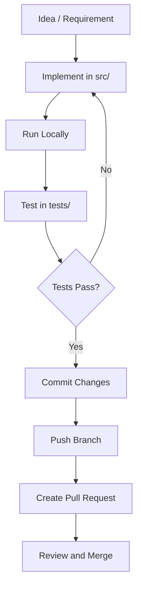
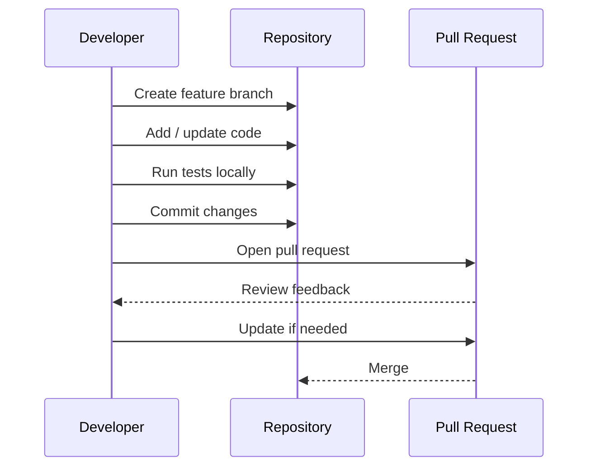

# Codexa

Codexa is a clean and practical project starter designed to help you build, organize, and scale software projects with clarity.
It gives you a professional repository structure, clear setup steps, and a documented development workflow so you can start coding immediately.

---

## ✨ Features

- Clean and scalable project foundation
- Easy onboarding for new developers
- Ready-to-follow setup, run, and test instructions
- Structured documentation and contribution process
- Development workflow with architecture and flow diagrams

---

## 🧱 Project Structure

```text
Codexa/
├── README.md
├── src/               # Source code
├── tests/             # Test files
├── docs/              # Documentation
├── scripts/           # Utility scripts
├── .gitignore
└── config files       # package.json / pyproject.toml / etc.
```

---

## ⚙️ Getting Started

### 1) Clone the repository

```bash
git clone <your-repository-url>
cd Codexa
```

### 2) Install dependencies

If your project uses **Node.js**:

```bash
npm install
```

If your project uses **Python**:

```bash
python -m venv .venv
source .venv/bin/activate
pip install -r requirements.txt
```

### 3) Run the project

Node.js example:

```bash
npm run dev
```

Python example:

```bash
python src/main.py
```

### 4) Run tests

Node.js:

```bash
npm test
```

Python:

```bash
pytest
```

---

## 🧩 Architecture Overview



---

## 🔄 Development Flow



---

## 🛠 Development Guidelines

- Keep code simple, readable, and modular.
- Write tests for new features and bug fixes.
- Use meaningful commit messages.
- Keep PRs focused on one change.
- Update documentation whenever behavior changes.

---

## 🤝 Contributing

1. Fork the repository.
2. Create a branch:

```bash
git checkout -b feature/your-feature-name
```

3. Commit your changes:

```bash
git commit -m "Add meaningful message"
```

4. Push your branch.
5. Open a pull request.

---

## 🚀 Future Improvements

- Add CI/CD pipeline configuration
- Add linting and formatting automation
- Add release/versioning workflow
- Add deployment templates
- Add issue and PR templates

---

## 🧾 License

This project is provided as a starter template.  
You can use an MIT License for open usage.

---


